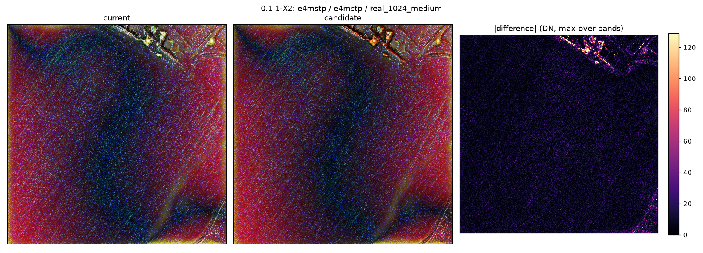
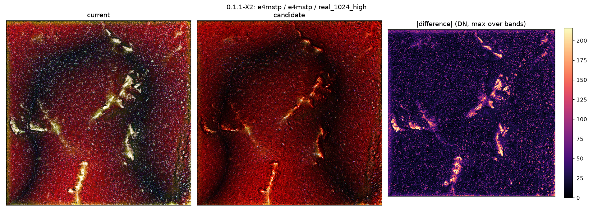
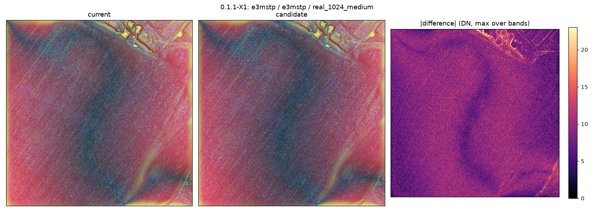
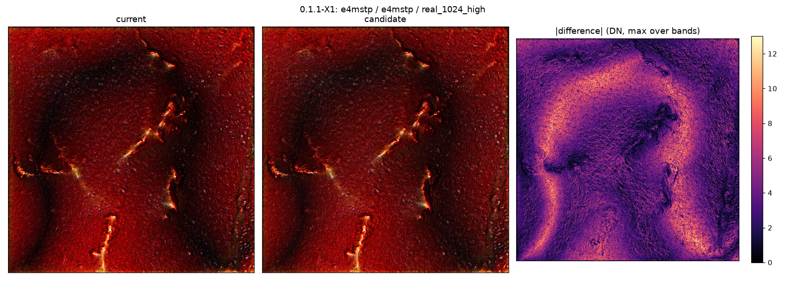

# Fixes in rvt_py_llm 0.1.1

0.1.1 fixes five defects of the blend path of `rvt`. Each fix makes the code do what its docstring and the
upstream documentation state; nothing is tuned visually. The outputs of CRIM, e3MSTP and e4MSTP change on purpose;
every other public function returns the same bits as `v0.1.0`, with and without numba (proof:
[TESTING.md](TESTING.md) section 7). Where the intent is not certain, the reading taken is stated with the
alternative as a question.

Data. *Tiles*: 1024 x 1024 px = 256 m at 0.25 m/px; `low` is the center of the low-relief test DEM, `medium` and
`high` are windows of the medium- and high-relief evaluation DEMs. *Full DEMs*: the three test DEMs, 10 000 x
8 000 px at 0.25 m/px, results cropped by 512 px = 128 m on every side (the MSTP broad radius is 500 px = 125 m).
DN = levels of the 8-bit display `round(clip(x, 0, 1) * 255)`, maximum over R, G, B. Repro of all five:
`python docs/repro/fixes_0_1_1.py [<checkout>]`, 8 / 8 checks as expected on 0.1.1, 0 / 8 on `v0.1.0`.

The notes are ordered by measured impact on the test data: X2 (e4MSTP p99.9 up to 206 DN) > X1 (up to 42 DN) >
X3 = X4 = X5 (0 DN). Every fix is the default behaviour, without a switch, and changes outputs on purpose (X1 is
bitwise exact at opacity 100). Not tested for any fix: Linux and macOS, the QGIS plugin, resolutions other than
0.25 m/px for the composites, DEMs other than the three test DEMs and synthetic tiles.

| id | defect | KI | patch | output changed |
|---|---|---|---|---|
| X2 | e4MSTP slope in radians, normalized over 0..55 | 47 | `0007-fix-X2-e4mstp-computes-the-slope-layer-in-degrees.patch` | e4MSTP |
| X1 | overlay and soft light write into the background; layer opacity has no effect | 33, 34 | `0008-fix-X1-overlay-and-soft-light-blend-into-a-new-array.patch` | CRIM, e3MSTP, e4MSTP |
| X3 | an operand outside [0, 1] is rescaled by broken functions that fill NaN | 19, 20, 21 | `0009-fix-X3-clip-blend-operands-to-0-1-scale_-as-document.patch` | only where an intermediate leaves [0, 1] |
| X4 | CRIM writes `svf_r_max = 10` into the caller's `DefaultValues` | 45 | `0006-fix-X4-color_relief_image_map-works-on-a-deep-copy-o.patch` | later calls that reuse the object |
| X5 | the opacity range check can never fail | 36 | `0005-fix-X5-BlenderLayer.check_data-rejects-an-opacity-ou.patch` | invalid inputs only (now raise) |

The patches are `git format-patch v0.1.0..v0.1.1`; 0001-0004 are the tests and proof tools written before the fixes.

## X2 e4MSTP computes its slope layer in degrees

- **Where.** `rvt/blend.py:2160` at `v0.1.0` called `rvt.vis.slope_aspect` with the default `output_units="radian"`
  and normalized over 0..55 (`:2185`); at `v0.1.1` `:2171-2172` pass `output_units="degree"`.
- **Reading.** The docstring "Colored slope (0-55)". Question: is 0..55 degrees the intended range? The
  alternative, radians over 0..0.9599 rad, differs by rounding only.
- **Evidence.** Random 40 x 40 px DEM (sigma 5 m, 1 m/px): the inverted slope layer spans 0.022 in radians, 0.706
  in degrees. Tiles: e4MSTP p99.9 46 / 105 / 205 DN, max 122 / 224 / 250 DN. Full DEMs, e4MSTP (X1 and X2): p99.9
  66 / 125 / 206 DN (low / medium / high), 73 / 88 / 94 % of pixels > 5 DN.
  
  
- **Change.** Patch 0007; changed on purpose, default.
- **Limits, risk.** Slopes now take the red end of the Reds_r ramp; the largest change of the release. e4MSTP
  measured at 0.25 m/px only.

## X1 Overlay and soft light blend into a new array, so their opacity applies

- **Where.** `rvt/blend_func.py:926` and `:969` at `v0.1.0` hand `background` to the in-place driver; at `v0.1.1`
  `:932` and `:979` hand it a copy.
- **Reading.** The documented opacities (CRIM overlay 50 %, e3MSTP soft light 70 %, e4MSTP overlay 90 %).
  Question: were these presets tuned with the 100 % look? Alternative: keep it, state 100 % in the docstrings.
- **Evidence.** Review repro c01 against `o * B(a, b) + (1 - o) * b` at opacity 0: error 0.47 (overlay), 0.24
  (soft light) on `v0.1.0`, 0 on 0.1.1. Tiles: e3MSTP p99.9 14 / 20 / 30 DN, max 32 / 41 / 42 DN; e4MSTP p99.9
  10-12 DN, max 13. Full DEMs, e3MSTP: p99.9 16 / 24 / 31 DN, max 42 DN.
  
  
- **Change.** Patch 0008; default; bitwise exact at opacity 100 (test).
- **Limits, risk.** KI-31 stays. User combinations with these modes below 100 % change.

## X3 Operands outside [0, 1] are clipped; the scale functions do what their docstrings say

- **Where.** `v0.1.0`: `rvt/blend_func.py:1294`, `:1298` (`_render_images`) and `rvt/blend.py:971`, `:975`
  (`render_all_images`) call `scale_0_to_1`; `scale_within_0_and_1` fills NaN (`:1365`), limits 0 and 1 (`:1369`,
  `:1372`); `scale_strict_0_to_1` fills NaN (`:1424`), raises (`:1432`). `v0.1.1`: `np.clip(x, 0, 1)` at
  `blend_func.py:1307`, `:1311`, `blend.py:982`, `:986`; actual limits (`:1380`, `:1383`), `&` (`:1395`, `:1437`).
- **Reading.** Clip, NaN stays NaN. Question: should the NaN mask instead be carried through `render_all_images`
  with the rescale kept?
- **Evidence.** `scale_0_to_1([-2, 3])`: `[-2, 3]` on `v0.1.0`, `[0, 1]` on 0.1.1; `scale_strict_0_to_1([1, 2,
  NaN])`: ValueError on `v0.1.0`. No image: 0 DN on the tiles.
- **Change.** Patch 0009; default.
- **Limits, risk.** Reached in e3MSTP on the three tiles by float rounding below 0 (minimum -1.5e-8 to -6.7e-8);
  the old snapping of (-0.01, 0) gave the same bits, so 0 DN. Full DEMs not probed.

## X4 color_relief_image_map works on a deep copy of `default`

- **Where.** `rvt/blend.py:1932` at `v0.1.0` set `default.svf_r_max = 10` on the caller's object (and on the
  default instance shared by all calls); at `v0.1.1` `:1943` copies `default` first.
- **Reading.** A function does not change its argument. The alternative, `default=None` with a new instance per
  call, changes the signature text and is not done.
- **Evidence.** `svf_r_max` set to 25 px stays 25 px after CRIM (10 px on `v0.1.0`). No image: 0 DN on the tiles.
- **Change.** Patch 0006; default; the first call of e3MSTP gives the same bits.
- **Limits, risk.** Only scripts that reuse one `DefaultValues` after e3MSTP see a change (their SVF and openness
  radius stays as set).

## X5 BlenderLayer.check_data rejects an opacity outside [0, 100]

- **Where.** `rvt/blend.py:280` at `v0.1.0`: `if 0 > self.opacity > 100`, never true; at `v0.1.1` `:287`:
  `if not 0 <= self.opacity <= 100`, raising `Exception` with the existing message, as the neighbouring checks.
- **Evidence.** Opacity 150 raises (accepted on `v0.1.0`). No image: 0 DN on the tiles.
- **Change.** Patch 0005; default.
- **Limits, risk.** Scripts that pass an opacity outside 0..100 now stop with an exception.

## Not changed in 0.1.1: questions

- KI-48: the e3MSTP docstring names Reds_r(0.5-1) for CRIM, the code uses OrRd 0..1. Which is intended?
- KI-49: `ve_factor` is not applied to MSTP nor to the slope layers of CRIM, e3MSTP and e4MSTP. Intended?
- The flat-terrain SVF radius of e4MSTP is the only radius in metres (`int(10 / resolution)` px); should the
  preset read the same at any resolution, or is it tuned for 0.5 m/px?
- KI-22: an opacity of 1 or less is read as a fraction (documented API); is 1 meant as 1 %?
- KI-46: the blend mode and opacity of the bottom layer are never used. Intended?
- KI-31: soft light keeps the background where the active layer is NaN; should it give NaN?
- KI-17: `no_data` is replaced by NaN in the caller's DEM (library-wide). Intended?
- e4MSTP fills `no_data` pixels with the `no_data` value, e3MSTP leaves NaN. Which is intended?
- `rvt.blend` still imports `scale_0_to_1`, which it no longer calls (kept so the name stays importable). Remove?
- After a min-max stretch no value lies in (-0.01, 0), so the snapping in `scale_*` does nothing. Remove?
- `scale_0_to_1` returns an array with maximum in (0.9, 1] and minimum 0 unchanged. Should it stretch it?
